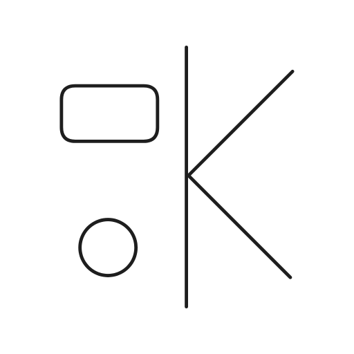
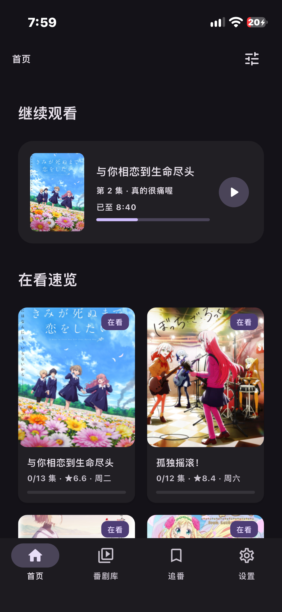
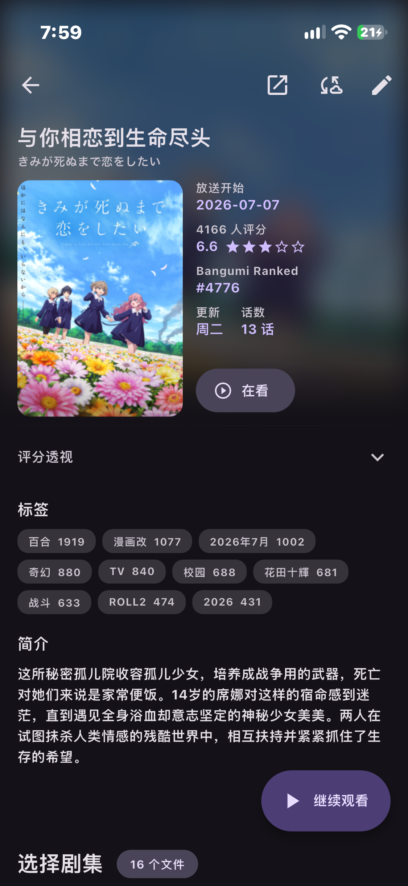
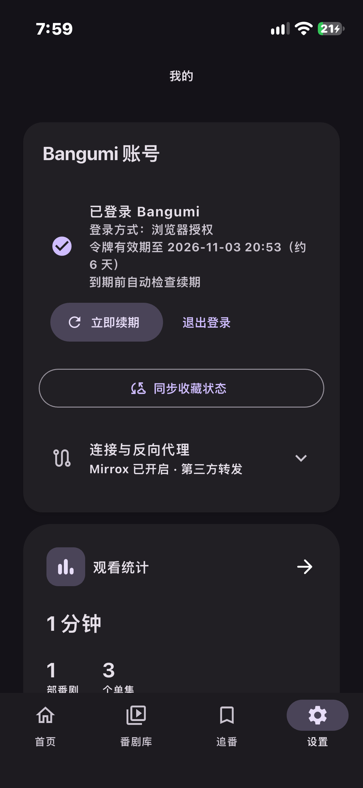
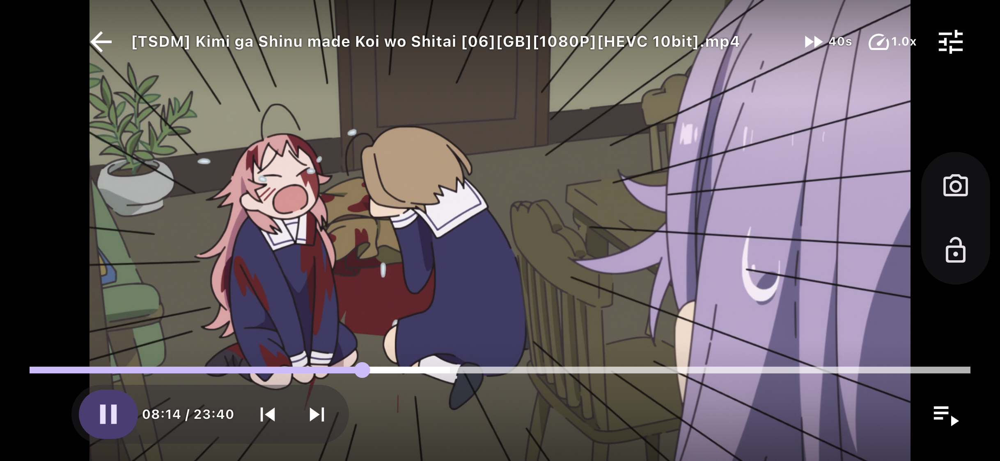
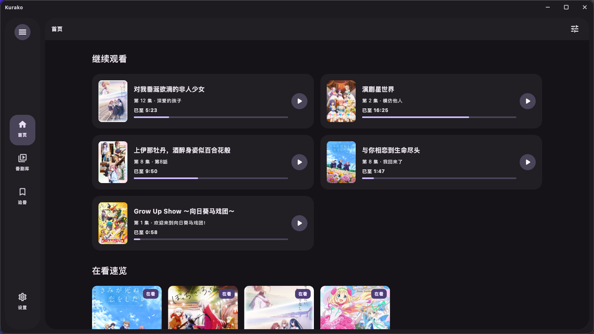
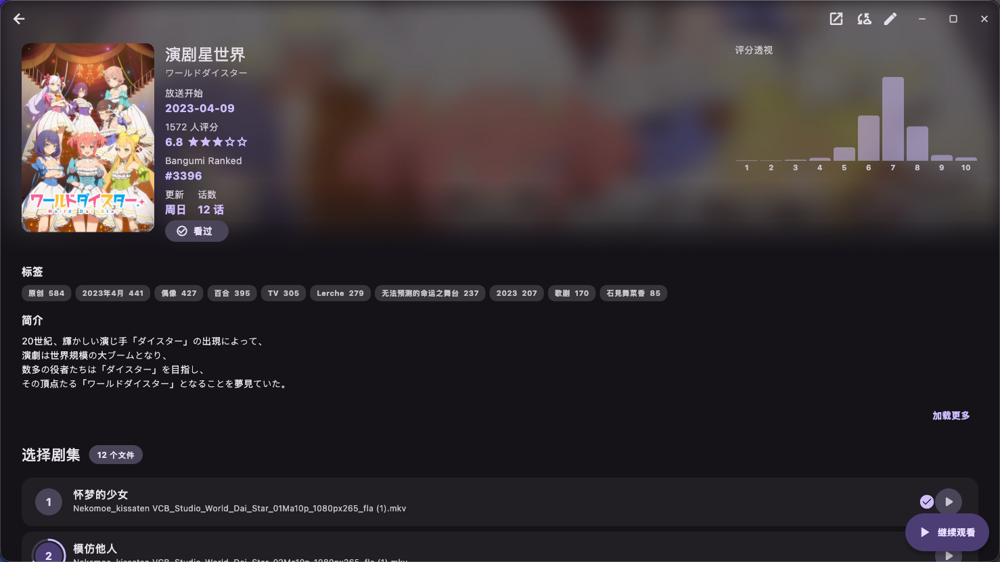
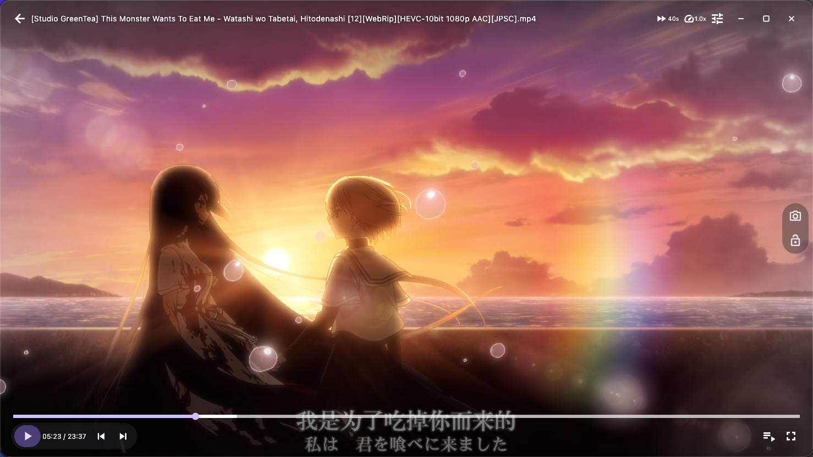
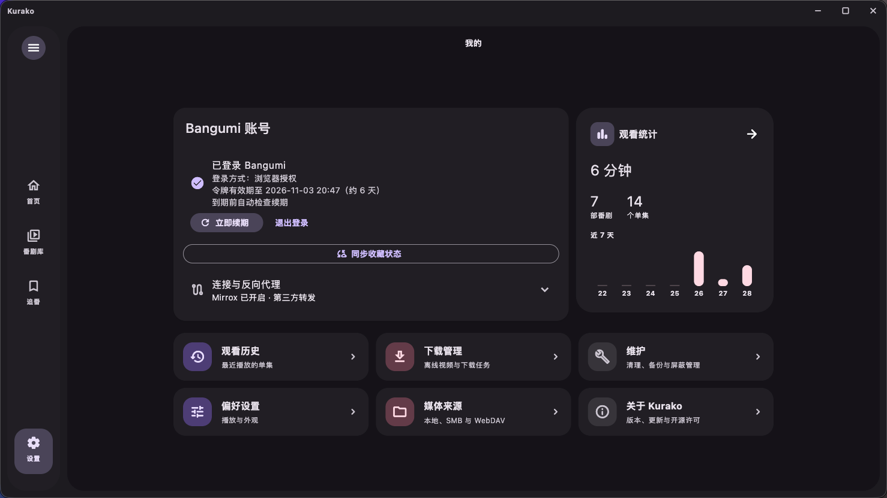

  

这个只是暂定的图标！ ...嗯，暂定的...

<h1 align="center">Kurako</h1>

使用 Flutter 与 Rust 构建的跨平台本地番剧库与视频播放器。

  
  
  

## 功能

- 扫描本地、SMB 与 WebDAV 媒体库，按文件名识别番剧与集数，支持增量扫描、去重和手动匹配。
- 接入 Bangumi 资料、评分、标签、收藏与剧集标题，并提供可选的反向代理访问方式。
- 独立首页汇总继续观看与在看速览，可配置模块显隐、顺序和启动页。
- 内置播放器支持外挂字幕、Anime4K、硬件或软件解码、续播、连播和系统媒体控制。
- 将 SMB、WebDAV 等媒体源中的视频及外挂字幕下载到本机，并在下载管理中播放、重试或清理。
- Material 3 Expressive 界面支持动态取色、外观预设、系统或霞鹜文楷字体，以及桌面竖版预览。
- 记录观看历史与统计，支持配置导入导出、更新检查和自定义键盘快捷键。

## 截图

### iOS / iPadOS

<table>
  <tr>
    <td width="33.3%"> 首页</td>
    <td width="33.3%"> 番剧详情</td>
    <td width="33.3%"> 设置</td>
  </tr>
  <tr>
    <td colspan="3"> 播放器</td>
  </tr>
</table>

### macOS

<table>
  <tr>
    <td width="50%"> 首页</td>
    <td width="50%"> 番剧详情</td>
  </tr>
  <tr>
    <td width="50%"> 播放器</td>
    <td width="50%"> 设置</td>
  </tr>
</table>

## 平台与分发

| 平台 | 最低版本 | 分发形式 |
| --- | --- | --- |
| Android | Android 7.0 / API 24 | `armeabi-v7a`、`arm64-v8a`、`x86_64` 单架构 APK |
| iOS / iPadOS | iOS / iPadOS 15 及以上 | `no_sign` IPA，由使用者自行签名和侧载 |
| macOS | macOS 12 及以上 | `arm64 + x86_64` 通用 App，使用 ad-hoc 签名封装为 DMG |
| Windows | 64 位 Windows 10 / 11 | Inno Setup 安装包与便携压缩包，当前未签名 |
| Linux（实验性） | Linux Mint 22.3 / Ubuntu 24.04 同代环境 | 仅提供 `x86_64` Debian `.deb` 测试包 |

> Linux 版本目前处于实验阶段，仅提供 x86_64 Debian `.deb` 包。不同桌面环境、显卡、驱动和发行版组合尚未完成全面验证，不提供 AppImage、Arch 包或 arm64 Linux 包。

正式安装包将在 [GitHub Releases](https://github.com/Tesget512/Kurako/releases) 提供。

## 构建

环境准备、各平台构建、签名与打包方式详见 [构建说明](docs/BUILDING.md)。

## 开源许可

Kurako 原创代码以 [GNU General Public License v3.0 only](LICENSE)（`GPL-3.0-only`）发布。

项目使用的第三方组件继续适用各自的许可证，主要组件、字体与来源见 [THIRD_PARTY_NOTICES.txt](THIRD_PARTY_NOTICES.txt)。分发二进制时应同时提供对应版本的完整源代码和许可证文本。

Copyright (C) 2026 Tesget512 and Kurako contributors.

## 致谢

Kurako 离不开以下开源项目与公共服务，感谢它们的维护者和贡献者：

- [Flutter](https://github.com/flutter/flutter) 与 [Rust](https://www.rust-lang.org/)：跨平台界面、应用层与核心能力。
- [flutter_rust_bridge](https://github.com/fzyzcjy/flutter_rust_bridge) 与 [Cargokit](https://github.com/irondash/cargokit)：连接 Flutter 与 Rust，并完成多平台原生构建。
- [Riverpod](https://github.com/rrousselGit/riverpod)：Flutter 状态管理。
- [media_kit](https://github.com/media-kit/media-kit) 与 [mpv](https://github.com/mpv-player/mpv)：跨平台视频、音频和字幕播放。
- [Anime4K](https://github.com/bloc97/Anime4K)：实时超分辨率着色器。
- [anitomy-rs](https://github.com/Rapptz/anitomy-rs)：动画文件名解析。
- [rusqlite](https://github.com/rusqlite/rusqlite)、[smb2](https://github.com/vdavid/smb2)、[reqwest](https://github.com/seanmonstar/reqwest) 与 [reqwest_dav](https://github.com/niuhuan/reqwest_dav)：本地数据库及 SMB/WebDAV 网络访问。
- [chardetng](https://github.com/hsivonen/chardetng) 与 [encoding_rs](https://github.com/hsivonen/encoding_rs)：外挂字幕编码识别与转换。
- [Bangumi API](https://bangumi.github.io/api/)：番剧资料、评分、收藏和剧集数据。
- [Mirrox](https://bangumi.lat)（作者 sakurairo，MIT）：社区维护的 Bangumi 反向代理，为 API、封面和可选登录链路提供备用访问方式。
- [Kazumi](https://github.com/Predidit/Kazumi)：番剧详情页布局与交互参考。
- [霞鹜文楷](https://github.com/lxgw/LxgwWenKai)：应用界面与字幕字体。

同时感谢项目依赖的其他 Flutter packages、Rust crates 和各平台开源组件。完整第三方许可与来源见 [THIRD_PARTY_NOTICES.txt](THIRD_PARTY_NOTICES.txt)。

开发过程中使用了 Claude Sonnet 5.5、OpenAI Codex 等 AI 编程工具辅助实现与审查；相关提交保留实际参与工具的 `Co-authored-by` 记录。
